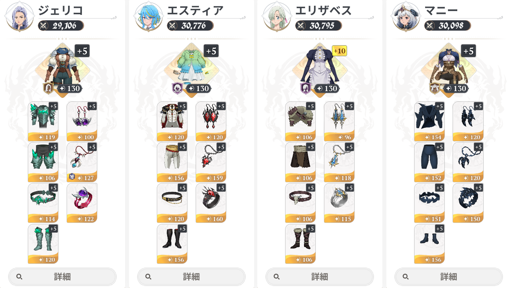
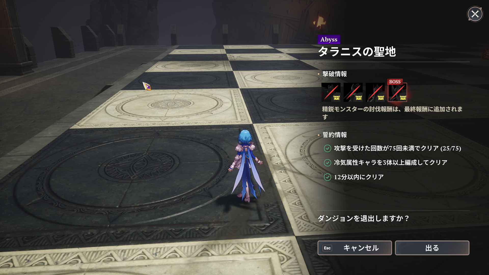

## 初めに
タラニスレイド (Abyss) をエスティアで攻略してみたのでそのまとめ。

### ゲームシーズン・バーションなど
ver 2.3

## タラニスの聖地 (Abyss) の攻略
道中気を付けることとしては、エスティアの通常攻撃が密着でヒットしないため、ギミック解除には注意が必要ということ。

今回チェックメイト前にクリアしたためチェスピースの破壊に関しては未検証。ただアプデでチェスピースの耐久が大幅減したため問題にならないと考えています。

### 選択した誓約

- 12分以内にクリア
- 冷気属性キャラの3体以上編成してクリア
- 攻撃を受けた回数が75回未満でクリア

## 編成
ここから私が使用した編成・採用キャラについてまとめていきます。

レイド装備は ALL120 でやれればよかったのですが今回対応できていません。

### パーティ構成 (冷気染め 廉価版 エスティア)
|キャラ|潜在力|武器|防具・アクセ|役割|
|---|---|---|---|---|
|エスティア|4 + 2|レイピア|貪欲な支配者 7set|アタッカー|
|ジェリコ|4 + 1|ランス|命の水晶 4set   呪いの脈動 2set   盟約のトーテム|シールド・冷気要員|
|マニー|4 + 3|双剣 (炎火)|「深淵」の捕食者 7set|デバフ|
|エリザベス|4 + 0|魔導書|監視者の防具 4set   再生の賛歌 3set|回復・バフ・デバフ|

#### 【レイピア】 エスティア
アタッカー運用する場合は最低 2凸 欲しい。3凸 あると尚良さそう。正直 無凸 はかなり使い辛いです。

#### 【ランス】 ジェリコ
クロト未所持のため冷気埋めで採用。

シールド付与と少量のバフがあるため使えなくはないといったところ。

#### 【双剣】 マニー
改めてみると冷気のデバフ枠としてかなり優秀なキャラです。

3凸効果のスイッチゲージ回復でローテを回しやすいのも良い。

#### 【魔導書】 エリザベス
とりあえず困ったらこれ。

### パーティのローテーション
基本ローテーションは以下の通り。

1. マニー: 特殊 ×2 ➔ スキル ➔ クイックスワップ
2. エリザベス: スキル ➔ 特殊
3. エスティア: 貪欲 1段階目 発動
4. ジェリコ: 特殊 ➔ スキル
5. エスティア: 貪欲 2段階目 発動 ➔ ※
6. マニーに戻る 

- ここで言う クイックスワップ とはスキルや特殊の直後にすぐキャラチェンをすること
- ジェリコのスキルは最終打撃ヒットでシールド付与のため注意
- エスティアのスキル回しに関しては下記参照

#### ※エスティアのスキル回しについて

1. 特殊 ➔ スキル ➔ 必殺
2. 特殊➔ 通常攻撃 ➔ スキル ➔ 必殺
3. 2を魔力ゲージ尽きるまでループ

- 必殺を撃つと特殊のCTリセット
- 特殊攻撃上の敵にスキルを撃つと必殺のCTリセット (1凸効果) 
動き回る相手には注意
- 通常攻撃でスキルのCT減少 (2凸効果)

### キャラの代用

- エリザベス out ➔ ティオレー in  
回復だけなら代用になり得る。

- ジェリコ out ➔ クロト in  
クロト未所持のためエアプですがジェリコよりは良いと思われる。

## クリアタイム
スクショし忘れましたが、試運転一発目でのクリアタイムは 11分半ば くらいで 12分 切りギリでした。 

メインアタッカーの育成はまだ済んでいないものが多いので、諸々終われば 10分 は切れそうです。

