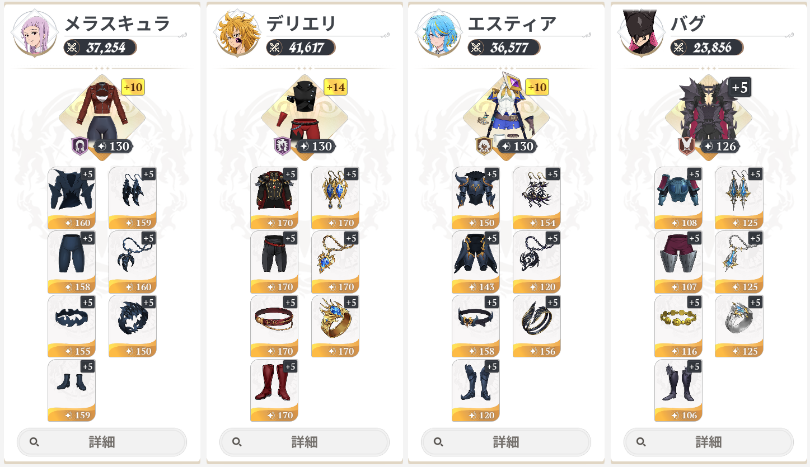
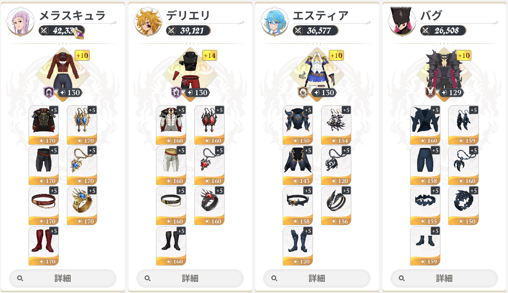
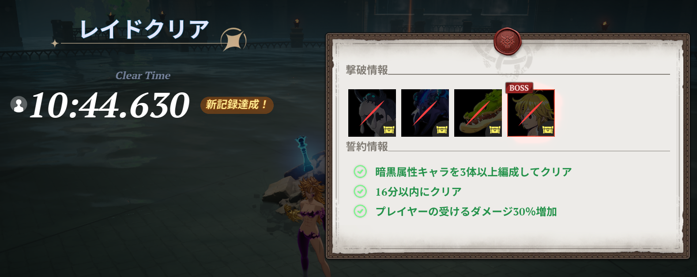

## 初めに
コルディン地下水路 (Abyss) の攻略まとめ。

今回は デリエリ と新キャラである メラスキュラ を採用した暗黒パーティを使用しました。

### シーズン・バージョンなど
ver 2.4

## コルディン地下水路 (Abyss) の攻略

### 道中にエスティアが欲しい
エスティアが無い場合、水中ギミックに付き合わされるため面倒です。

ワンドであればパーティを選ばす編成できるので、所持していれば採用の価値はあります。

#### エスティア採用のメリット
- 水位を下げるギミックのところはエスティアでスルー可能 
水位そのままに、下半開きの扉の所をペンギンで泳いで抜ける 
少し抜けづらいため、頭を地面にこすりつけるように進む

- レンタルカワウソ不要 
水中はペンギン形態の方が早い

### 毒による即死
水に触れている間毒ゲージが蓄積し、溜まりきると即死します。

毒の解除は泡に触れるだけと簡単なので、意識していれば問題はないでしょう。

ただ、2体同時の精鋭ボス と ラスボス は油断すると即死するため、泡の位置を把握しておくと良い。

### 選択した誓約

- 16分以内にクリア
- 暗黒属性キャラの3体以上編成してクリア
- プレイヤーの受けるダメージ30%増加

## 編成
ここから私が使用した編成・採用キャラについてまとめていきます。

### パーティ構成 (暗黒染め デリエリ)
|キャラ|潜在力|武器|防具・アクセ|役割|
|---|---|---|---|---|
|デリエリ|4 + 1|ガントレット|貪欲の権化 7set|アタッカー|
|メラスキュラ|4 + 3|レイピア|「深淵」 の捕食者 7set|バフ・デバフ|
|エスティア|4 + 2|ワンド|爆裂の影 7set|回復|
|バグ|4 + 6|魔導書 (炎火)|監視者の防具 4set   再生の賛歌 3set|暗黒要員・デバフ|

### 追記 パーティの改良
メラスキュラ・デリエリに 貪欲の権化(または貪欲な支配者) を装備し、デリエリとメラスキュラのダブルアタッカーで火力を出す。

魔力ゲージはメラスキュラの 3凸 効果で確保し、メラスキュラ必殺 ➔ デリエリ必殺完走 が安定します。

|キャラ|潜在力|武器|防具・アクセ|役割|
|---|---|---|---|---|
|デリエリ|4 + 1|ガントレット|貪欲な支配者 7set|アタッカー|
|メラスキュラ|4 + 3|レイピア|貪欲の権化 7set|バフ・デバフ|
|エスティア|4 + 2|ワンド|爆裂の影 7set|回復|
|バグ|4 + 6|魔導書 (誘惑の旋律)|「深淵」 の捕食者 7set|暗黒要員・デバフ|

- 理想は 貪欲の権化 7set × 2
- バックアタックの重要性が上がる
- 再生の賛歌を装備していないため、初動の魔力ゲージに注意 
爆裂の影 のセット効果で魔力ゲージをケア 
エスティアの防具を 野生の咆哮 にして 再生の賛歌 を装備するのも手

#### 【ガントレット】 デリエリ
久しぶりに攻略でデリエリを使えました。

育成状況の進捗

- 刻印装備パッシブを Lv3 に
- 刻印超越 +14 解放 ( 必殺技ダメージ +50% )
- 貪欲の権化装備

#### 【レイピア】 メラスキュラ
立ち位置としては汎用サポーターになると思います。

3凸目の効果が重要で、メラスキュラの必殺後、他のキャラで必殺を使う際の魔力ゲージ枯渇を防げます。

#### 【ワンド】 エスティア
装備は新装備である 爆裂の影 を採用しました。

バックアタックをするならスキルを使う前が良いと思います。

#### 【魔導書】 バグ
誓約要員。ささやかなデバフを2つ持っていますが、どちらとも条件的に使い辛いです。

特殊攻撃 ➔ 通常攻撃4hit で与える 暗黒属性耐性デバフ は刻印装備の効果誘発条件であるため、できれば発動させたいところ。

必殺技の方は魔力ゲージ的に使用は難しいです。

スキルの透明化 (隠れ身) は戦闘中に使うと敵の位置がリセットされ全快する可能性があるため注意する。

### パーティのローテーション

0. スキル・特殊を使いスイッチゲージを確保しておく
1. バグ：特殊 ➔ 通常攻撃 4hit
2. メラスキュラ：スキル全ヒット ➔ 通常 5hit ➔ 特殊 ➔ 必殺
3. デリエリ：スキル2連 ➔ 特殊4連 ➔ 必殺 ➔ 追加必殺
4. エスティア：スキル ➔ 特殊
5. 1に戻る

- エスティア時、バックアタックは状況次第で行う、無理に狙いに行かなくて良い
- エスティアの特殊は使用後即キャラチェン

### キャラの代用・入れ替え

- バグ out ➔ ガントレット バン in 
未所持のためエアプ、選択肢の1つとして。

## クリアタイム
今回の編成でのクリアタイムは 10:44.630

